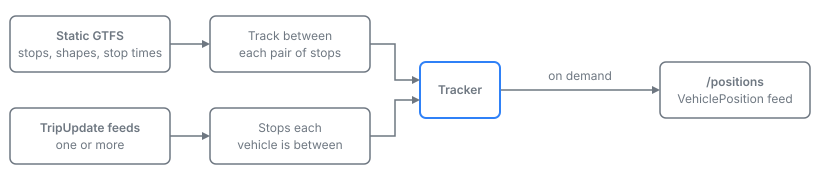
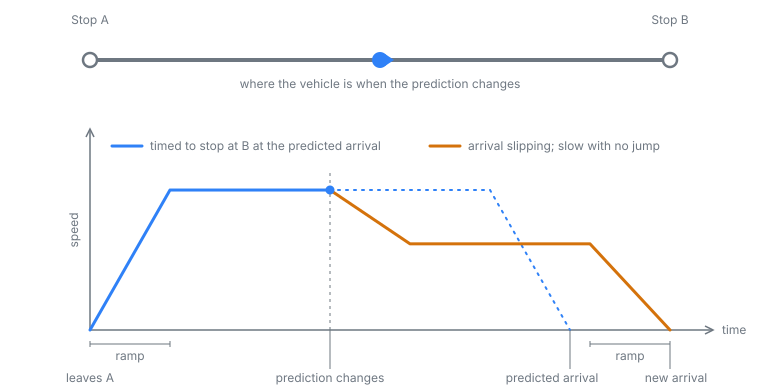

# GTFS position interpolator

A tiny server to generate missing GTFS-RT VehiclePosition feeds on demand. It interpolates positions from TripUpdates and static GTFS data, serving a GTFS-RT [VehiclePosition](https://gtfs.org/documentation/realtime/reference/#message-vehicleposition) feed.

## How it works



- **Track:** Each trip's shape is cut into segments between consecutive stops. If there are no shapes, segments will be straight lines.
- **Position:** A vehicle is between the last stop time in the past and the next stop time, timed to arrive at the prediction.
- **Motion:** A vehicle accelerates for 15 seconds, cruises, and brakes for 15 seconds. When a prediction changes it speeds up or slows down rather than jumping.
- **Vehicles:** Vehicles that haven't started their trip or provided an update in 10 minutes are excluded.
- **Delays:** Feeds that give delays rather than times are resolved against the static schedule.



## Running

```sh
go run . -config configs/nyc-subway.json
```

The feed is at <http://localhost:8080/positions>. The static feed is downloaded at startup, cached on disk and refreshed daily.

Flags: `-config` (required), `-addr` (default `:8080`) and `-cache-dir` (where the static feed is cached).

## Configuration

See `configs/nyc-subway.json` for an example.

## Endpoints

| Path | Description |
|---|---|
| `/positions` | The VehiclePosition feed, as protobuf. `?route=A,C,E` limits it to those route IDs. Readable from a browser on any origin. |
| `/healthz` | JSON health of each upstream feed. Returns 503 if any has not changed for two minutes. |

Each vehicle's `timestamp` is its last upstream update. The header timestamp is when the positions were computed.

## Demo UI

`ui/` is a separate map of the `/positions` feed, for illustration and debugging.

```sh
cd ui
npm install
npm run dev
```

It needs a [Mapbox](https://docs.mapbox.com/mapbox-gl-js/) public token set as `VITE_MAPBOX_TOKEN` in `ui/.env.local` (gitignored). The other settings default, in `ui/.env`, to the NYC subway and a server on `localhost:8080`:

| Setting | Description |
|---|---|
| `GTFS_STATIC_URL` | Static GTFS zip, for the routes, stops and track drawn on the map. |
| `GTFS_STATIC_REFRESH_HOURS` | How old the map's copy of the static feed can get. 24 by default. |
| `VITE_POSITIONS_URL` | The server's `/positions` endpoint. |

Adding `lat`, `lon` and `zoom` to the page address sets where the map opens.
